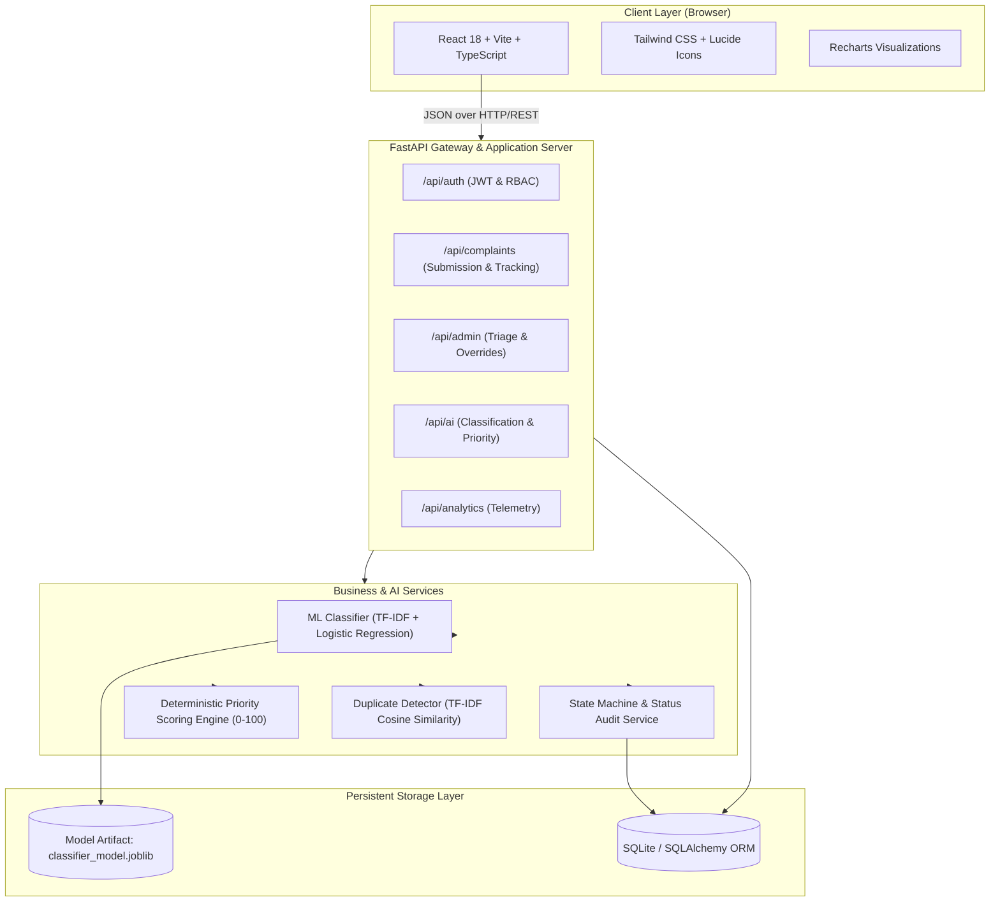
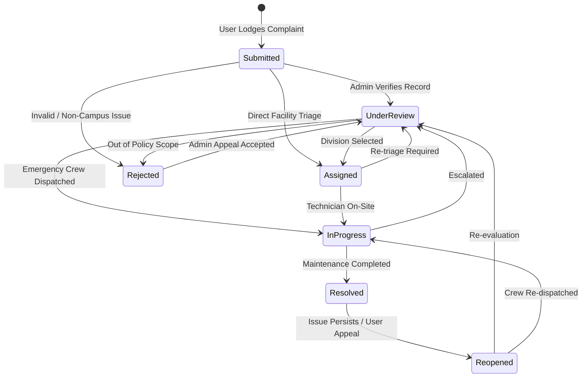
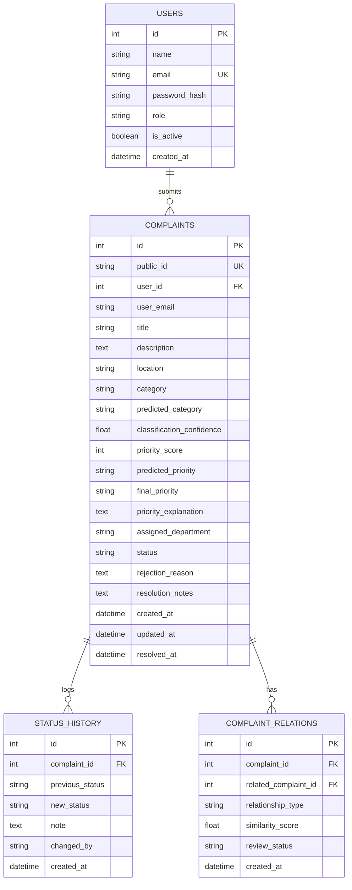

# ComplainAI — System Architecture Document

## 1. High-Level Architecture Overview

ComplainAI is designed around a decoupled, layered architecture adhering to the principle that the backend is the authoritative source of truth for business logic, persistence, and AI inference.

---

## 2. Core Backend Modules

- **`main.py`**: FastAPI application entry point, CORS middleware, static asset fallback for client-side routing, and application health endpoint.
- **`database.py`**: SQLite database connection, thread-safe session generator (`get_db`), declarative base model.
- **`models.py`**: SQLAlchemy ORM models: `User`, `Complaint`, `StatusHistory`, `ComplaintRelation`.
- **`schemas.py`**: Pydantic v2 schemas providing type safety and request/response validation.
- **`auth.py`**: JWT token creation, verification, password hashing with direct `bcrypt`, role-based dependency injections (`get_current_user`, `get_current_admin`).
- **`services/classifier.py`**: Scikit-learn Pipeline wrapper providing text normalization, vectorization, category inference, confidence scoring, uncertainty flagging, and feature token explainability.
- **`services/priority.py`**: Policy-governed priority engine scoring safety risk, service disruption, affected population, and issue duration.
- **`services/duplicates.py`**: Cosine similarity computation across recent database records to flag potential duplicates.
- **`services/audit.py`**: State machine validation enforcing valid complaint lifecycle transitions and recording dated audit records.

---

## 3. Complaint Lifecycle State Machine

ComplainAI implements a strict state machine to prevent unauthorized or nonsensical status leaps (e.g., an unreviewed complaint cannot jump directly to Resolved).

---

## 4. Entity-Relationship Data Model

---

## 5. Security & Role-Based Access Control (RBAC)

1. **Password Hashing**: Passwords are cryptographically salted and hashed using `bcrypt` (cost factor = 12).
2. **Access Control**: Administrative endpoints (`/api/admin/*`) require valid JWT bearer tokens with `role == 'admin'`. Public registration is locked to the `user` role.
3. **Database Injection Protection**: All queries are executed using SQLAlchemy ORM parameterized statements.
4. **Public Privacy**: Public tracking IDs (e.g. `RX-2026-ELE001`) use non-sequential, randomly generated hex strings that prevent sequential ID scraping.

